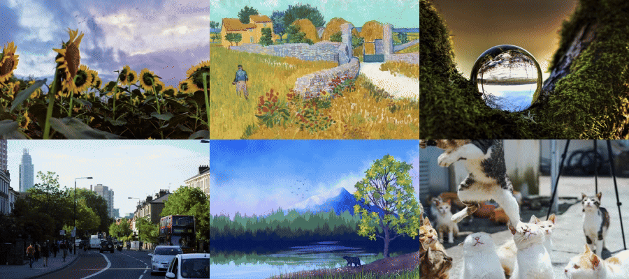
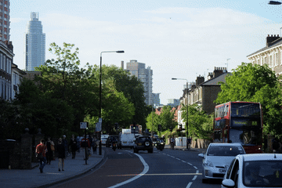
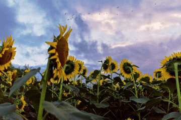
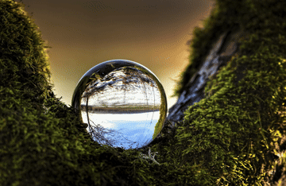
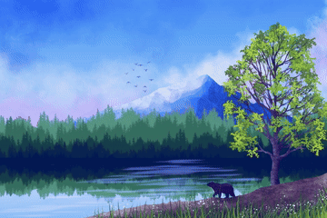
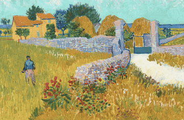

<div align="center">

# Parallax Anything

**Turn any photo into a cinematic 3D camera move, on a laptop, in seconds.**



[](LICENSE)


[Demo video](demo/parallax_anything_demo.mp4) · [Quick start](#quick-start) · [How it works](#how-it-works) · [Gallery](#gallery) · [Cite](#citation)

</div>

---

Parallax Anything repurposes **[Depth Anything V2](https://github.com/DepthAnything/Depth-Anything-V2)**, a
state-of-the-art *monocular depth estimation* model, into a **photo-to-video generator**. It estimates depth,
splits the scene into layers, invents (inpaints) the background hidden behind foreground objects, and flies
a virtual camera through the result. You get the "2.5D / Ken Burns 3D" effect used in documentaries,
music videos and social reels, from a single still image.

- **One command:** `python infer.py --input photo.jpg`
- **7 camera moves:** `orbit`, `swing`, `bob`, `dolly`, `zoom-out`, `crane`, `vertigo` (Hitchcock dolly-zoom)
- **No tearing:** layered rendering with occlusion inpainting instead of a stretched single mesh
- **Cinematic depth of field** (`--dof 1`) driven by the real depth map
- **Seamless loops** for `orbit` / `swing` / `bob` / `vertigo`, great for GIFs and wallpapers
- **Runs anywhere:** CUDA, Apple Silicon (MPS) or CPU. Model is 25M params / 99 MB, fully Apache-2.0
- **MP4 + GIF + depth-map export**, batch a whole folder, or use the Python API

## Gallery

| Dolly (street) | Orbit + depth of field | Vertigo (dolly-zoom) |
|:---:|:---:|:---:|
|  |  |  |
| **Crane (painting)** | **Orbit (Van Gogh)** | **Swing** |
|  |  |  |

Full showcase with input photos and depth maps: **[demo/parallax_anything_demo.mp4](demo/parallax_anything_demo.mp4)**

## Quick start

```bash
git clone https://github.com/working-codes-demo/parallax-anything.git
cd parallax-anything
pip install -r requirements.txt
bash scripts/download_checkpoints.sh      # optional, infer.py auto-downloads on first run
python infer.py --input assets/examples/street.jpg --motion dolly --gif
```

Output goes to `outputs/`: `street_dolly.mp4`, `street_dolly.gif` and `street_depth.png`.

### More examples

```bash
# every camera move for every photo in a folder
python infer.py --input assets/examples --motion all

# dramatic Hitchcock zoom with shallow depth of field, 6 seconds
python infer.py -i portrait.jpg -m vertigo --dof 1 --duration 6 --strength 1.3

# subtle, loopable wallpaper at 4K-ish
python infer.py -i landscape.jpg -m swing --strength 0.6 --max-size 3840 --gif
```

### Inference options

| Flag | Default | What it does |
|---|---|---|
| `--input, -i` | required | image file or a folder of images |
| `--output, -o` | `outputs` | where results are written |
| `--motion, -m` | `orbit` | `orbit` `swing` `bob` `dolly` `zoom-out` `crane` `vertigo`, a comma list, or `all` |
| `--duration` | `4.0` | clip length in seconds |
| `--fps` | `30` | frame rate |
| `--strength` | `1.0` | camera travel: `0.5` subtle … `2.0` dramatic |
| `--dof` | `0` | depth-of-field blur (try `1`) |
| `--focus` | auto | disparity `0..1` that stays still (auto = the subject in the middle of the frame) |
| `--layers` | `4` | max number of depth layers |
| `--z-far` | `8` | perceived scene depth (bigger = flatter background) |
| `--max-size` | `1920` | long side of the output video |
| `--gif` | off | also export an optimised GIF |
| `--model` | `vits` | `vits` (Apache-2.0) or `vitb` (better depth, **CC-BY-NC, non-commercial**) |
| `--device` | `auto` | `cuda`, `mps`, `cpu` |
| `--manifest` | none | append one JSON line per result (for pipelines) |

### Python API

```python
from parallax_anything import ParallaxPipeline, ParallaxConfig

pipe = ParallaxPipeline()  # loads Depth Anything V2 Small once
result = pipe.run("photo.jpg", "outputs", ParallaxConfig(motion="vertigo", dof=1.0, duration=5))
print(result["video"], result["seconds"])
```

## How it works

```
photo ──► Depth Anything V2 (ViT-S, flip-TTA) ──► disparity map
                                                     │
                           edge-preserving clean-up + foreground dilation
                                                     │
                 cut at histogram valleys (= real depth jumps, never through objects)
                                                     │
        per layer: RGBA + depth, background behind nearer layers inpainted (coarse→fine Telea)
                                                     │
 for every frame: camera pose ─► exact inverse perspective warp per layer (4-step fixed point)
                                 ─► premultiplied back-to-front compositing ─► optional depth-of-field
                                                     │
                                         ffmpeg ─► MP4 / GIF
```

Key ideas:

1. **Cut where the scene is empty.** Layer boundaries are chosen in the *valleys* of the disparity histogram,
   so they sit on real depth discontinuities. Cutting through a populated depth range would slice objects in
   half, and the halves tear apart when the camera moves.
2. **Hallucinate only what can be revealed.** Each layer inpaints a band behind nearer content that is as wide as
   the largest parallax the chosen camera path can produce. The band is inpainted twice as wide as it is kept,
   so foreground colours never bleed into the visible part.
3. **Exact projection, not a 2D shift.** Every pixel is a 3D point. The renderer inverts the perspective
   projection per pixel (a fixed-point iteration over the layer's depth), which keeps slanted surfaces such
   as roads, floors and walls geometrically correct during dolly and vertigo moves.
4. **Automatic overscan.** The tool solves for the smallest zoom that keeps the frame border inside the photo
   over the whole camera path, so you never see black edges.

## Performance

Measured on an Apple M3 Pro laptop (MPS backend), 1600×1064 output, 4 s @ 30 fps (120 frames):

| Stage | Time |
|---|---|
| Depth estimation (ViT-S + flip-TTA) | 0.2 s |
| Layer building + inpainting | 3.0 s |
| Rendering 120 frames | 13.6 s (~9 fps) |
| H.264 encoding | 3.7 s |
| **Total per clip** | **~20 s** (+5 s with `--gif`) |


## Ideas to build on

- **Social reels / YouTube b-roll:** animate still photos for documentaries and explainers
- **Product shots:** subtle `swing` loops for e-commerce listings
- **Old photos and paintings:** bring archives and artworks to life (see the Van Gogh example)
- **Live wallpapers:** loopable `orbit` clips at 4K
- **Mobile/edge:** Depth Anything V2 Small exports to Core ML / ONNX for on-device apps

## Project layout

```
infer.py                       # inference CLI (single image, folder, all motions)
parallax_anything/
  depth.py                     # Depth Anything V2 wrapper, checkpoint download + checksum
  layers.py                    # depth clean-up, valley cuts, layered inpainting
  camera.py                    # camera paths (orbit, dolly, vertigo, ...)
  render.py                    # GPU renderer: inverse projection, compositing, depth of field
  pipeline.py                  # end-to-end photo -> video
  video.py                     # ffmpeg MP4 / GIF writers
  third_party/depth_anything_v2/  # vendored upstream model code (Apache-2.0)
scripts/
  download_checkpoints.sh      # fetch + verify the 99 MB checkpoint
  make_demo.py                 # builds demo/parallax_anything_demo.mp4 and demo/hero.gif
tests/test_core.py             # projection round-trip, layering and loop tests
```

Run the tests with `python -m pytest -q` (no checkpoint needed).

## Citation

If you use Parallax Anything in a paper, video or project, please cite this repository
(GitHub's **"Cite this repository"** button gives the same entry in APA and BibTeX):

```bibtex
@software{parallax_anything_2026,
  author  = {{working-codes-demo}},
  title   = {Parallax Anything: Turn Any Photo into a Cinematic 3D Camera Move},
  year    = {2026},
  version = {0.1.0},
  url     = {https://github.com/working-codes-demo/parallax-anything},
  license = {Apache-2.0}
}
```

A ⭐ on the repo also helps other people find it.

## Acknowledgements

Parallax Anything builds on these open-source projects:

- [Depth Anything V2](https://github.com/DepthAnything/Depth-Anything-V2): depth model. Code and the **Small**
  checkpoint are Apache-2.0; Base/Large checkpoints are CC-BY-NC-4.0.
- [DINOv2](https://github.com/facebookresearch/dinov2): backbone layers, Apache-2.0.
- Example photos come from the Depth Anything V2 repository's `assets/examples` and belong to their owners.

## License

[Apache License 2.0](LICENSE). Third-party notices are in [NOTICE](NOTICE).
